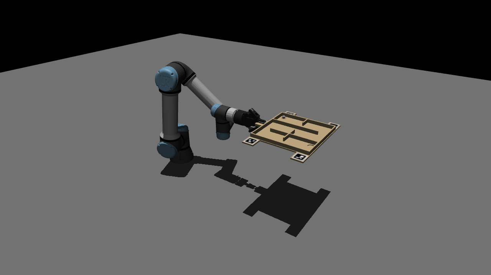
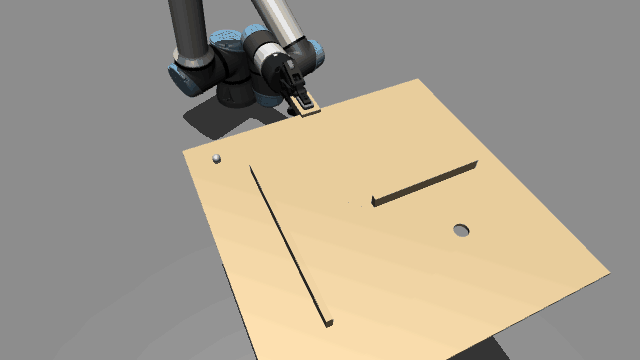
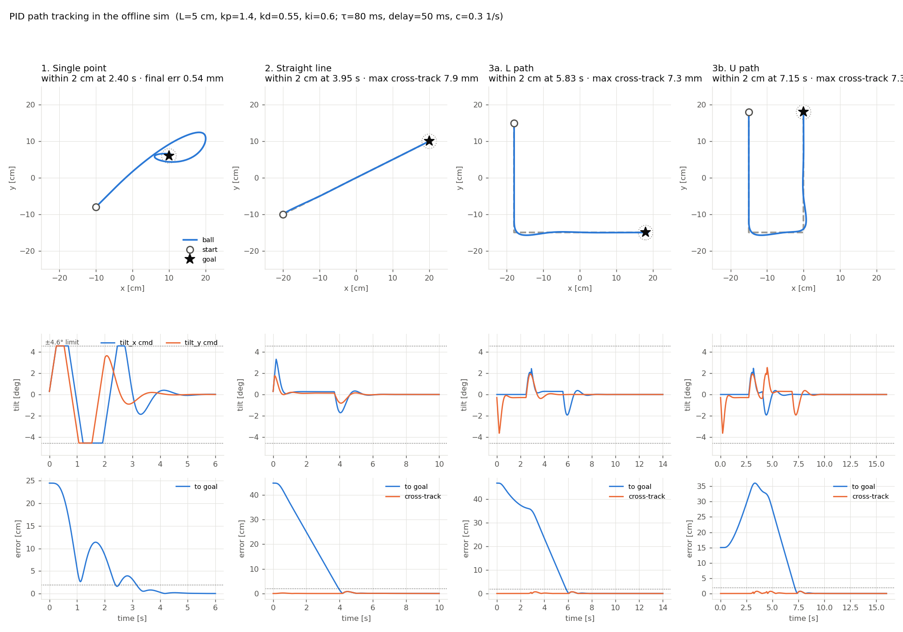

# ee206-project: UR7e ball-in-maze

EECS C106A / C206A final project. A UR7e holds a maze board by its edge and tilts it to roll a ball from start to goal as fast as possible without dropping it into a hole. An overhead webcam maps the maze and tracks the ball; the pipeline is developed in a MuJoCo simulation behind the same ROS 2 interface as the robot.

## Team

| Name | Email |
|---|---|
| TienChun (Leo) Chen | leotcchen@berkeley.edu |
| Jing Xu | jing_xu1112@berkeley.edu |
| Chelsea Yan | chelseayan@berkeley.edu |
| Zhuoren Li | gabriel.li@berkeley.edu |
| Steven Wu | chiachien_wu@berkeley.edu |

## Links

- Proposal: [`proposal/206A_Final_Project_Proposal.pdf`](proposal/206A_Final_Project_Proposal.pdf) (source: [`proposal/main.md`](proposal/main.md))
- Work plan and task status: [GitHub Project board](https://github.com/users/leokim10073/projects/1)

## Branches and commits

Work happens on `feat/<area>` branches and merges into `main` through pull requests.

Start every commit title with the area in brackets, for example `[proposal] switch project to UR7e ball-in-maze` or `[sim] add ball friction`.

## Development environment (distrobox)

Everything runs inside one container, so nothing is installed on your machine. You only need [podman](https://podman.io) (or Docker) and [distrobox](https://distrobox.it).

Build the image and create the container once:

```bash
./docker/build.sh
distrobox assemble create --file docker/distrobox.ini
```

Enter it whenever you work on the project:

```bash
distrobox enter maze-sim
```

Your home directory is shared with the container, so the repo is at the same path inside. ROS 2 Humble is already sourced. The container does not write your dotfiles or `~/.local`; it sets `PYTHONNOUSERSITE=1` so Python packages from your own `~/.local` do not override the image's.

An NVIDIA GPU is used for the sim camera if present. `distrobox enter` reads your `~/.bashrc`, so an `RMW_IMPLEMENTATION` set there applies inside too; the image has both Fast DDS (the Humble default) and Cyclone DDS, and the tests pass on both. Use the same one as the robot's computer.

The prompt looks the same inside and outside the container, because distrobox keeps your hostname and `~/.bashrc`. `echo ${CONTAINER_ID:-host}` prints `maze-sim` inside. Running `distrobox enter` again from inside fails with "we need a container manager".

After `docker/` changes (yours or from a `git pull`), rebuild and recreate; an existing container keeps the old image:

```bash
distrobox rm -f maze-sim && ./docker/build.sh && distrobox assemble create --file docker/distrobox.ini
```

## Simulation

A MuJoCo scene of the lab UR7e holding the maze board with its Robotiq 2F-85, plus an overhead camera, behind the same ROS 2 interface as the real robot. Lab code switches between sim and robot by changing the launch file, not the code. The design is in [`docs/superpowers/specs/2026-11-08-simulation-s1-design.md`](docs/superpowers/specs/2026-11-08-simulation-s1-design.md).



*The start pose after the automatic reset, rendered from the sim's own MuJoCo scene: the L1 maze, its four ArUco stickers and the ball in the start cell.*

### Prerequisites

The `maze-sim` container from [Development environment](#development-environment-distrobox) holds ROS 2 Humble, MuJoCo, `mujoco_ros2_control` and every Python package the sim needs.

### Build and run (inside `maze-sim`)

```bash
source /opt/ros/humble/setup.bash
colcon build
source install/setup.bash
ros2 launch maze_sim_bringup sim.launch.py
```

| Argument | Default | Meaning |
|---|---|---|
| `config` | `maze_sim_description/config/sim.yaml` | Scene and camera configuration |
| `viewer` | `true` | Open the MuJoCo viewer; `false` runs headless |
| `camera` | `true` | Render and publish the overhead camera |

The launch validates `sim.yaml` first and stops with a message naming the bad key. A few seconds after start, the sim runs one `/sim/reset` so the gripper is squeezing the handle and the ball sits at rest on a level board; `/sim/reset_done` (latched) says when that is done.

**Speed.** Every 10 s the sim logs `real-time factor: <x.xx>` (sim time ÷ wall time). On the owner's machine (RTX 5070 Ti) with `viewer:=true camera:=true` it reads **1.00**. If your machine cannot keep up, sim time slows down evenly (no physics steps are skipped) and the log warns. Lab-style nodes that run on the wall clock then see the arm move less per second than on the robot; close other programs or launch with `camera:=false`.

### Try it

Leave the launch running and open a second terminal on the host. Every terminal that talks to the sim needs the same `RMW_IMPLEMENTATION` and `ROS_DOMAIN_ID` as the one running it, which holds when both come from your `~/.bashrc`.

```bash
distrobox enter maze-sim
cd <repo> && source install/setup.bash
```

Overhead camera image:

```bash
ros2 run rqt_image_view rqt_image_view /camera/image_raw
```

Open the gripper (answers `opened`; the board falls), then put everything back (~1.5 s):

```bash
ros2 service call /toggle_gripper std_srvs/srv/Trigger
ros2 service call /sim/reset std_srvs/srv/Trigger
```

Velocity control, as the lab does it: switch from the trajectory controller to the velocity controller, then stream joint velocities (rad/s, in `/joint_states` order). The last entry turns `wrist_3`, which tilts the board about its x axis, so the ball rolls. Ctrl-C stops publishing and the arm stops.

```bash
ros2 control switch_controllers --deactivate scaled_joint_trajectory_controller --activate forward_velocity_controller
ros2 topic pub -r 50 /forward_velocity_controller/commands std_msgs/msg/Float64MultiArray "{data: [0, 0, 0, 0, 0, 0.1]}"
```



*Recorded from the sim through ROS: `wrist_3` at −0.1 rad/s for 0.5 s, +0.1 rad/s for 1 s, −0.1 rad/s for 0.5 s (a 3° tilt each way). Rendered from the recorded joint and pose topics with the sim's MuJoCo scene.*

Back to the trajectory controller (lab 3 and lab 7 use it):

```bash
ros2 control switch_controllers --deactivate forward_velocity_controller --activate scaled_joint_trajectory_controller
```

### Interfaces

Same names and types as the lab UR7e.

| Name | Type | Notes |
|---|---|---|
| `/joint_states` | `sensor_msgs/JointState` | The 6 UR joints only, 500 Hz |
| `/forward_velocity_controller/commands` | `std_msgs/Float64MultiArray` | 6 joint velocities, rad/s (inactive at start) |
| `/forward_position_controller/commands` | `std_msgs/Float64MultiArray` | 6 joint positions, rad (inactive at start) |
| `/scaled_joint_trajectory_controller/joint_trajectory` | `trajectory_msgs/JointTrajectory` | Active at start (lab 3) |
| `/scaled_joint_trajectory_controller/follow_joint_trajectory` | action `control_msgs/FollowJointTrajectory` | Lab 7 |
| `/controller_manager/*` | `controller_manager_msgs` services | `ros2 control switch_controllers` works unchanged |
| `/tf`, `/tf_static` | `tf2_msgs/TFMessage` | `world` → `base_link` → … → `tool0`, and `world` → `camera_optical_frame` |
| `/toggle_gripper` | `std_srvs/Trigger` | Opens a closed gripper or closes an open one (lab 5); answers `opened` / `closed`. Opening drops the board |
| `/camera/image_raw` | `sensor_msgs/Image` | `rgb8`, 1280×720 at 60 fps by default (C922 model) |
| `/camera/camera_info` | `sensor_msgs/CameraInfo` | Pinhole intrinsics from resolution and `hfov_deg`, zero distortion |

Sim only, no robot equivalent:

| Name | Type | Notes |
|---|---|---|
| `/sim/ball/pose`, `/sim/board/pose` | `geometry_msgs/PoseStamped` | Ground truth in `world`, 100 Hz, for checking perception |
| `/sim/reset` | `std_srvs/Trigger` | Arm to `initial_joints`, gripper closed, board in the grasp, ball at `ball.start`, at rest (~1.5 s) |
| `/sim/reset_done` | `std_msgs/Empty` (latched) | Published after each reset |
| `/sim/camera/depth` | `sensor_msgs/Image` | Float depth, m |
| `/clock` | `rosgraph_msgs/Clock` | Sim time; every sim node runs with `use_sim_time:=true` |

Things that differ from the robot, on purpose or by the simulator:

- The camera publishes at 62.5 Hz (frames land on whole 2 ms physics steps). A slow subscriber of the 2.7 MB images can miss some (a Python subscriber gets ~56 Hz, less on a busy machine), because the publisher keeps only the newest frame. A GPU that cannot render a frame within its slot publishes fewer (an Intel Iris Xe gets ~55 Hz in sim time), and the sim logs `camera at <x> fps (sim time), below camera.fps`.
- `camera_info` puts the principal point at (w/2, h/2), half a pixel off the ROS pixel-centre convention.
- While the gripper is closed on the board, a weld holds the board in the grasp (`GraspWeldPlugin` in `maze_sim_nodes`). MuJoCo's friction is soft, so a board held by contacts alone creeps out of the grasp (about 0.014°/s while the arm moves, whatever the friction or finger force), where the real pads would not. The weld switches on only for a board within 5 mm and 3° of its grasp pose, and off as soon as the gripper opens, so dropping and regrasping still go through contacts and gravity. Held, the board still flexes up to ~0.6 mm / 0.2° against the fingers.
- Physics and the controllers run on separate threads, so the same command sequence after `/sim/reset` gives the same ball path to within ~2 mm while the ball rolls free; after the ball hits walls, runs differ by up to ~1 cm, as on real hardware.

### Board export (Steven)

MuJoCo cannot read STEP, so export the board from CAD as STL. `maze_CAD/scripts/export_sim.py --level <L>` does this and writes the parts to `maze_CAD/levels/<L>/sim/` (see [`maze_CAD/README.md`](maze_CAD/README.md)):

| Part | File | Use in the sim |
|---|---|---|
| Base plate with holes | `base.stl` | Convex-decomposed (CoACD) so the holes stay open; also the visual |
| Handle | `handle.stl` | Convex-decomposed; the fingers grip it |
| Each wall | `wall_<n>.stl`, one per wall | Collides as its convex hull, so each wall must be one straight box: split an L-shaped or bent wall into straight pieces, or it fills its corner |
| Shallow pocket (e.g. the goal) | a through hole in `base.stl` plus a convex `wall_<n>.stl` disk as its floor | CoACD fills a pocket that does not go through, and the ball rolls over it |
| ArUco stickers (optional) | `aruco/aruco_<corner>.obj` + `.png` | Drawn with their texture, never collide |
| Goal hole | center and radius | Typed into `sim.yaml` (`board.goal_hole`); `parts_report.json` has the values |

All parts in one shared frame: origin at the board center, z up, z = 0 on the maze floor (the plate's top face), so the ball spawns at z = ball radius. State the units. Then convert (inside `maze-sim`):

```bash
build_board_assets maze_CAD/levels/L1/sim --units mm --out-dir src/maze_sim_description/meshes/board
colcon build
```

The tool replaces every mesh and marker texture in `--out-dir` and writes `board.json`, which lists the meshes the sim loads and the units they came from. Set `board.units` in `sim.yaml` to the same units: the launch refuses a mismatch, and refuses a board whose size is 1000× off, both with a message about `board.units`.

### `sim.yaml` reference

[`src/maze_sim_description/config/sim.yaml`](src/maze_sim_description/config/sim.yaml) holds every adjustable value; all keys are required.

| Key | Meaning |
|---|---|
| `camera.position`, `look_at`, `up` | Camera pose in `world` (m); `up` is the world direction shown as image up, must not be parallel to the view direction |
| `camera.resolution`, `fps`, `hfov_deg` | Image size, rate and horizontal field of view |
| `robot.ur_type`, `initial_joints` | UR model and start/reset joint angles (rad); the default holds the board level |
| `gripper.closed_position`, `force_limit` | Finger closure at the handle (0–1) and grip force (N) |
| `board.mesh_dir`, `units` | Converted board meshes (`package://`, absolute, or relative to `sim.yaml`) and the STL units |
| `board.grasp_offset` | Handle frame relative to `tool0` (`xyz` m, `rpy` rad) |
| `board.mass`, `surface_friction`, `goal_hole` | Board mass (kg), felt friction (sliding, torsional, rolling), goal hole in the board frame |
| `ball.radius`, `mass`, `start`, `friction` | Steel ball; `start` is xy in the board frame |
| `physics.timestep`, `real_time_factor`, `noslip_iterations` | 2 ms steps, target speed (1.0 = wall clock), grasp contact solver iterations |

### Tests (inside `maze-sim`)

```bash
colcon build && source install/setup.bash
python3 -m pytest src/maze_sim_description/test
cd src/maze_sim_bringup && python3 -m pytest test
```

The bringup tests launch the whole sim headless (about 70 s). They refuse to start while another sim is running, since it would answer the same services; stop it first. The sim's process can print a segfault on shutdown; that is an upstream `mujoco_ros2_control` bug and harmless.

## Perception

`maze_perception` turns the overhead camera image into board coordinates. Work package: #13. So far: P1, the board pose from the four ArUco corner markers, and a rectified top-down image of the board; P3, the ball's position from that; P4, the ball's state (position, velocity, tracking flag) on `/ball/state` ([contract 2](docs/interfaces.md)); P5, robustness to webcam images and offline replay of rosbags. The maze map is not built here: it comes from the CAD (`maze_cad_map`, #18).

The geometry, the ball finder and the filter are plain Python libraries (`board_pose.py`, `ball.py`, `ball_filter.py`, no ROS). `ball_tracker` is the ROS node around them: per camera frame it finds the markers once, then the board pose, the ball and the filtered state. `board_tracker` is the same without the ball, for the board pose alone.

### Run (inside `maze-sim`, next to the sim)

```bash
colcon build && source install/setup.bash
ros2 launch maze_perception perception.launch.py   # from the repo root
```

This also starts `maze_cad_map` for `/maze/map`, which `ball_tracker` needs to look for the ball; pass `with_map:=false` if it already runs. On the robot, add `use_sim_time:=false`. Look at the rectified board with `ros2 run rqt_image_view rqt_image_view /perception/board_image`.

| Topic | Type | Notes |
|---|---|---|
| `/perception/board_pose` | `geometry_msgs/PoseStamped` | Board frame in the camera optical frame, stamped with the image; only for frames where the board was found |
| `/perception/board_image` | `sensor_msgs/Image` | Rectified top-down image of the plate, `rgb8`, 600×600 (2 px/mm), image right = board +x, image up = board +y; 5 Hz (`rectified_rate`) |
| `/tf` | | `camera_optical_frame` → `maze_board`, so `world` → `maze_board` comes out of TF next to the sim's `/sim/board/pose` |
| `/ball/state` | `maze_interfaces/BallState` | Contract 2: every camera frame, stamped with the capture time, `maze_board`; best effort, keep last 1 |

The board frame is the sim's and the CAD's: origin at the plate center, z up, z = 0 on the maze floor, handle on −x, m. Every 10 s the node logs frames/s, the share of frames with a board pose and with the ball, ms per frame, and the capture-to-publish latency of `/ball/state`.

[`config/perception.yaml`](src/maze_perception/config/perception.yaml) holds the marker layout (from `maze_CAD/levels/L1/sim/parts_report.json`, checked by a test), `min_markers`, the reprojection limit, the rectified image area, the ball's size, floor area and thresholds, and the filter's noise levels.

### Accuracy

On the sim's own camera image, with the board tilted up to 6° and shifted up to 2 cm in the grasp: board position within 0.5 mm and orientation within 0.12° of `/sim/board/pose`, corners reprojected within 0.75 px.

- **3 of the 4 markers are enough** (points on the board within 1 mm), so one marker hidden by the gripper is fine. With only 2 the tilt is ambiguous (up to 7° off, 6.6 mm on the board), so `min_markers` is 3.
- **OpenCV ≥ 4.7 is needed.** Ubuntu's OpenCV 4.5 found all four markers in only 0–7 of 8 synthetic board images, depending on the color around the stickers; 4.10 found them in 8 of 8. The `maze-sim` image now installs `opencv-contrib-python-headless` 4.10, so **rebuild the container** (see [Development environment](#development-environment-distrobox)); `test_markers.py` fails in an old one.
- `DICT_4X4_50`, 40 mm markers: at the sim camera's 1 m a marker is about 45 px wide, which 4×4 handles with margin.

### Ball (P3)

`ball.py` (no ROS) finds the ball's center in one camera image, in the board frame: a raw measurement per frame, no filtering (that is P4).

- **On the ball's plane.** The image is rectified at z = ball radius, where the ball's center lies ([contract 2](docs/interfaces.md)), so a rectified pixel is directly the (x, y) of a ball centered there. The z = 0 floor would put it off by up to a millimeter at the board's edge.
- **Only the floor counts:** inside the outer walls (`ball.floor`, checked against the CAD), inside the camera image, and not where a wall of the maze map (`/maze/map`) shows, from its foot to its top (`wall_height`, 18 mm) as the camera sees it. The ball is never in a wall; wall ends and blurred wall lines would otherwise look like it.
- **Not floor, ball-shaped.** The image is smoothed a little (0.5 mm). Each pixel's CIELAB distance from the floor color (median over the floor), less twice the floor's own spread (camera noise, JPEG, uneven light), is divided by `not_floor` (20) and capped at 1, so a black wall counts no more than the grey ball. The ball is where a disc of its radius is most unlike the floor compared with the ring around it. Whether it is the ball is scored there on its core (0.8 radii) against the ring 1.2–1.7 radii out, leaving out the edge band that blur, JPEG's half-resolution color and motion smear. A ball scores about 0.8; at least `min_score` (0.5) counts.
- **No ball color assumed.** The sim ball is grey on a tan floor; the real ball is steel on whatever the C922 makes of the real board. Tested also with dark steel on a light floor, a bright ball on a dark floor, and a green print.
- **Walls don't push it.** The outer walls' dark inner faces lie just outside the floor in the image; counting them would push a ball against the wall about 2 mm off. `floor_outline()` places the wall foot as seen at the ball's height from the board pose, and only the floor inside it counts.
- **Seen whole or not at all:** a ball partly outside the camera image is not reported (`rectified_coverage()` marks what the camera saw).
- **Coarse to fine:** square filters at half resolution, then the disc at full resolution around the best spot, refined to a fraction of a pixel. About 10 ms per frame on a laptop CPU, rectification included.

On the sim's camera image (L1, board tilted up to 6° and shifted up to 2 cm, random ball positions, half of them against a wall): median error 0.5 mm, max 1.8 mm against `/sim/ball/pose`. Ball scores ≥ 0.78; with the ball off the board, nothing scores above 0.31 (a wall end) with the board held as gripped. Slipped 2 cm in the grasp, a gripper finger reaches over the outer wall and scores up to 0.53, a false ball; the real grasp does not slip like that (the sim's holds within 0.5°), and while the ball is tracked the filter's gate ignores it.

Not yet: the threshold and `not_floor` need checking on the real board (P6). Robustness to camera effects: P5 below.

### Ball state (P4)

`ball_filter.py` is a constant-velocity Kalman filter (state x, y, vx, vy in `maze_board`) run at each image's capture time; `ball_tracker` publishes its state on `/ball/state`, one message per camera frame.

- **Timing (contract 2):** the state is the one at `header.stamp`, the image's capture time; a controller predicts forward to now itself (`x + vx * (now − stamp)`). The node logs how far behind publishing is.
- **Ball or board not found:** the filter's prediction with `tracking_ok = false`, every frame, and a covariance that grows. After `lost_reset` (1 s) without the ball it forgets it (zeros, all-zero covariance = unknown) rather than extrapolating. Subscribers stop the run after `tracking_timeout` (0.2 s) anyway.
- **Misdetections:** a measurement more than `max_jump` (2 cm) plus 3σ from the prediction is not used (that frame is `tracking_ok = false`). A gate on distance, not a tight statistical one: a ball stopped by a wall lands a few mm off the prediction and must count. After `max_rejects` (3) in a row the ball really is there (picked up and put back) and the track restarts.
- **`accel_noise` (1 m/s²) trades steadiness for speed:** the speed error does not depend on how fast the ball goes, so for a slow ball it matters most. With 0.3 mm (1 mm) of per-frame measurement noise:

  | `accel_noise` | speed error at any speed | after a 0.3 m/s wall stop |
  |---|---|---|
  | 0.5 | 6 (12) mm/s | settled in 4–6 frames, 3–5 mm past the wall |
  | **1** | **10 (20) mm/s** | **3–4 frames, 2–3 mm** |
  | 2 | 16 (33) mm/s | 2–3 frames, 1–2 mm |

  The ball rolls at most ~0.5 m/s (5° tilt, 0.6 m/s², the longest L1 straight); a controller that keeps it at a few cm/s can lower `accel_noise` to 0.5. The real camera's per-frame noise is to be measured in P6.

In the sim (arm tilting the board up to 4° about two wrist joints every 0.7 s, ball rolling into walls and corners at up to 0.15 m/s, 62.5 Hz frames): position error 1.3 mm rms (2.4 mm max), speed error 25 mm/s rms, up to ~0.2 m/s for a frame or two when it hits a wall. Most of the position error is the ball against a wall: there the measurement is ~1.5 mm off the wall (P3 leaves the wall's dark faces out, and with them the ball's outermost millimeter).

### Robustness and offline replay (P5)

**Degraded camera images.** The sim's own images (L1, 24 renders: tilted and slipped board, 16 with the ball), degraded the ways a webcam is, through the whole pipeline (markers, pose, ball, with the CAD walls):

| Degradation | Board found | Ball found | Error median / max | Lowest ball score |
|---|---|---|---|---|
| none | 24/24 | 16/16 | 0.5 / 1.8 mm | 0.84 |
| noise σ 10 / 20 gray levels | 24/24 | 16/16 | 0.6 / 1.5 mm | 0.73 |
| defocus σ 1 / 2 px | 24/24 | 16/16 | 1.1–1.9 / 3.8 mm | 0.61 |
| JPEG quality 50–90 (the C922 sends MJPEG) | 24/24 | 16/16 | 0.8–1.1 / 2.2 mm | 0.66 |
| ball smeared 3–15 px (0.2–1 m/s in a 16 ms exposure) | 24/24 | 16/16 | 0.8–2 / 5.5 mm | 0.56 |
| darker ×0.3–0.5, gamma 0.5–2, white balance off | 24/24 | 16/16 | ≤ 0.8 / 1.9 mm | 0.52 |
| light varying 0.3–1.5× across the board | 24/24 | 16/16 | 0.6 / 1.6 mm | 0.77 |
| all at once, mildly (light 0.7–1.1, defocus 1 px, noise 6, JPEG 70) | 24/24 | 16/16 | 1.1 / 2.1 mm | 0.83 |

With no ball and the board held as gripped, nothing scored above 0.40 under any of these. What these fixes were for: before P5, noise σ 20 lost every ball, JPEG lost some even at quality 90, and a defocused wall end was taken for the ball.

Where it stops, to be handled on the camera side in P6:
- **Focus.** From defocus σ 2.5 px the ArUco cells (about 7 px at 1 m) blur together and the board is lost; no detector setting brings them back. Turn the C922's autofocus off and fix the focus at the board.
- **Overexposure.** At twice the exposure the tan floor and the grey ball both clip to white and the ball is gone. Set the exposure by hand so the floor stays below saturation (the sim camera already overexposes the board a little, ee206-project#20).
- **Camera shake** of 10 px in an exposure loses the markers. The board moves far less than that between frames; only the ball smears, which is fine up to 15 px.

**Offline replay.** `replay_bag` runs `ball_tracker`'s per-frame work over a rosbag, offline, so a recording from the sim or the robot can be rerun after every change:

```bash
ros2 bag record /camera/image_raw /camera/camera_info /maze/map /sim/ball/pose /sim/board/pose   # sim
ros2 run maze_perception replay_bag <bag> --csv replay.csv
```

It takes raw or compressed images. The walls come from the bag's `/maze/map`, else from the CAD (`--cad-scripts`, `--level`). With the sim's `/sim/ball/pose` and `/sim/board/pose` in the bag, each frame gets the ball's true position in the board frame and the errors are summed up. The CSV has one row per frame: board found, the raw measurement and its score, the filtered state, `tracking_ok`, and the truth. The bag is read twice (first all but the images, then image by image), so a long bag never has to fit in memory.

### Tests (inside `maze-sim`)

```bash
colcon build && source install/setup.bash
cd src/maze_perception && python3 -m pytest test
```

`test_sim_render.py` renders the MuJoCo scene offline (no ROS) and compares the board pose, the ball and the ball state of a rolling ball against ground truth; `test_node.py` runs `board_tracker` and `ball_tracker` over ROS on synthetic images; `test_replay.py` writes a rosbag and replays it (the bag part needs ROS).

## CAD maze map

`maze_cad_map` publishes a level's maze map from `maze_CAD/scripts/levels.py` on `/maze/map` (contract 1 in [`docs/interfaces.md`](docs/interfaces.md)), and the walls alone on `/maze/map/walls` for RViz. It is the only map source, in the sim and on the real board: the camera only finds the board pose and the ball.

Run it from the repo root, inside `maze-sim` (the default `cad_scripts` path is relative to it):

```bash
colcon build && source install/setup.bash
ros2 launch maze_cad_map cad_map.launch.py            # level:=L1, use_sim_time:=false on the robot
```

The grid is 60 × 60 cells of 5 mm over the plate, in `maze_board`, row 0 on the −y edge; holes, start and goal are circles and points next to it. `maze_cad_map/cad_map.py` builds the map without ROS, for tests.

### Tests (inside `maze-sim`)

```bash
colcon build && source install/setup.bash
cd src/maze_cad_map && python3 -m pytest test
```

They check the walls, start and goal against the sim export (`parts_report.json`) and `sim.yaml`, and that a subscriber that starts late still receives the map.

## Control

`maze_control` tilts the board so the ball follows the planned path. So far: a PID path tracker, the baseline before MPC, and an LQR with a delay predictor.

The control code is plain Python (numpy, no ROS) and is tested against an offline ball simulator; `pid_node` is the ROS node around it. Pieces every controller shares live in `common/`, and each controller gets its own subpackage, so an MPC goes next to `pid/` as `mpc/`:

```
src/maze_control/
  maze_control/common/   path_tracker.py (look-ahead target on the path), ball_sim.py (offline sim),
                         config.py (YAML loader), scenarios.py (test paths)
  maze_control/pid/      pid_law.py (two-axis PID), controller.py (tracker + PID + watchdog), node.py
  config/                pid.yaml (gains, limits, signs, topics), sim.yaml (offline sim plant)
  launch/                pid.launch.py
  scripts/               plot_trajectories.py
```

### Run (inside `maze-sim`)

```bash
colcon build && source install/setup.bash
ros2 launch maze_control pid.launch.py use_sim_time:=true   # false (default) on the robot
```

| Topic | Type | Notes |
|---|---|---|
| `/ball/state` (in) | `nav_msgs/Odometry` | `pose.pose.position.x/y` [m], `twist.twist.linear.x/y` [m/s] in the board frame, 60 Hz; placeholder type until the ball tracker exists |
| `/maze/path` (in) | `nav_msgs/Path` | Board frame, m; a new path restarts tracking, the same path republished does not |
| `/board/tilt_cmd` (out) | `geometry_msgs/Vector3Stamped` | `x` = θx, `y` = θy [rad], frame `maze_board`, 60 Hz |

Board frame as in [Perception](#perception): origin at the plate center, +x right, +y up seen from the camera. θy > 0 rolls the ball to +x and θx > 0 rolls it to −y; both signs are parameters (`sign.*`).

[`config/pid.yaml`](src/maze_control/config/pid.yaml) holds every gain and limit: tilt 0.08 rad (4.6°) and 0.3 rad/s per axis, below arm control's hard limits of 0.087 rad and 0.5 rad/s ([contract 4](docs/interfaces.md)); look-ahead 5 cm; stop advancing within 2 cm of the goal.

Tracking loss ([contract 2](docs/interfaces.md)): states with `tracking_ok = false` are ignored. After 200 ms without a good state during a run, the board tilts back to 0 (rate limited) and the run stops (`status: stopped`). It stays stopped when the ball is found again; only a new path on `/maze/path` starts the next run.

### PID

Per axis, `u = kp·e − kd·v + ki·∫e`. `e` is the look-ahead target minus the ball position. The D term uses the Kalman-filter velocity rather than differentiating the position. The integrator runs only within 2 cm of the target, is capped, and freezes while the output is limited. The output is clipped to the tilt limit first, then to the rate limit.



Offline sim with a 14 mm steel ball, `a = (5/7)·g·sin θ − c·v`, an 80 ms tilt lag and 50 ms command delay: within 2 cm of the goal after 3.9 s (straight), 5.8 s (L) and 7.1 s (U), with at most 7.9 mm off the path. With a 120 ms lag, 100 ms delay and KF-like noise it still reaches the goal; at 150 ms + 150 ms it oscillates, so retune once the arm's latency is measured.

### LQR

```bash
ros2 launch maze_control lqr.launch.py use_sim_time:=false                        # robot: robust default
ros2 launch maze_control lqr.launch.py use_sim_time:=true \
    config:=$(ros2 pkg prefix maze_control)/share/maze_control/config/lqr_sim.yaml   # MuJoCo sim
```

`lqr_node` is a drop-in for `pid_node`: same topics, QoS, look-ahead target and tracking-loss rules (it reuses `PidPathController` and only swaps the control law). Run one of the two, never both.

Per axis it uses the model `p' = v`, `v' = (5/7)·g·θ − c·v`, `θ' = (u(t − delay) − θ)/τ` with state `[p − p_target, v, θ]` and `u = −K·x`. `K` comes from the discrete Riccati equation at the 60 Hz control period (zero-order hold), with Bryson's-rule weights in [`config/lqr.yaml`](src/maze_control/config/lqr.yaml) (`q_pos`, `q_vel`, `q_tilt`, `r`; optional integral `q_int`). The tilt `θ` is not measured: it is estimated by running the lag model on the commands sent. The commands still in flight are known, so the state is predicted `delay` ahead before `K` is applied. The output goes through the PID's tilt and rate limits.

Two configs, same keys:

- [`config/lqr.yaml`](src/maze_control/config/lqr.yaml), the default: a slow-arm model (80 ms lag, 50 ms delay), look-ahead 5 cm, no integral. Offline (`K = [3.74, 1.46, 0.63]`) it reaches the goal in 4.2 s (straight), 6.2 s (L) and 7.6 s (U), at most 8.9 mm off the path, and is stable up to an 80 ms lag + 50 ms delay in every test case. With a 120 ms lag, 100 ms delay and noise it stays within 9 mm of the path (PID: 16 mm). Use it on the robot until its latency is measured.
- [`config/lqr_sim.yaml`](src/maze_control/config/lqr_sim.yaml), tuned on the MuJoCo full chain (sim → perception → planner → LQR → `maze_arm_control`, L1, sim slowed to 0.05× so perception keeps up on a laptop). The model is identified from that chain: the measured tilt follows the command with ~20 ms dead time and ~10 ms lag, perception adds ~10 ms, the ball's rolling loss is ~1/s. With the integral on and a 3 cm look-ahead it reaches the L1 goal in 8.9 s, never within 3 mm of a wall (PID: 8.9 s, 0.7 mm closest; `lqr.yaml`: 11.7 s, touching walls 33% of the time). It assumes that fast arm: offline it diverges on a 24 cm error at 30 ms + 50 ms, so it is for the sim only.

Why 3 cm in the sim: with a 5 cm look-ahead the target point lies past the wall tip at a U-turn; after a replan from next to the tip the LQR pulled the ball straight into it and the ball stuck there. The predictor matters most with a long delay: at 150 ms of dead time `lqr.yaml` still tracks the L path when `model.delay` matches, and goes unstable with the predictor off. The LQR does not know the tilt limit, so heavier weights make it oscillate on large errors; that is what MPC adds.

### Tests (no ROS needed)

```bash
cd src/maze_control && python3 -m pytest test
python3 scripts/plot_trajectories.py   # rewrites docs/media/pid_trajectories.png
```

`test_pid_closed_loop.py` covers a single target (and that a flipped sign fails), straight, L and U paths. `test_pid_limits_watchdog.py` covers the tilt and rate limits, the timeout and the stopped run. `test_path_tracker.py` covers the shared tracker. `test_lqr.py` covers the LQR: the matrix exponential, the Riccati solution and a stable closed loop, the same paths and limits as the PID, the delay predictor, the tilt observer, the watchdog, and `lqr_sim.yaml` (tracks on the fast sim arm; diverges on a slow one, which pins the warning in its header).
